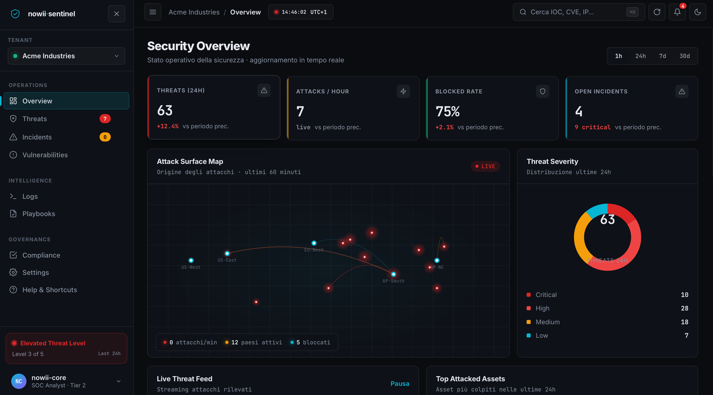

# nowii·sentinel — Security Operations Center

<p align="center">
  <b>An Enterprise Security Operations Center (SOC) Platform Built with Pure HTML, CSS, and JavaScript. No External Dependencies, No Backend.</b>
</p>

<p align="center">
  <a href="https://github.com/nowii-core/security/blob/main/LICENSE">
    
  </a>
  
  
  
  
</p>

<p align="center">
  <a href="#-overview">Overview</a> •
  <a href="#-key-features">Features</a> •
  <a href="#-tech-stack">Tech Stack</a> •
  <a href="#-keyboard-shortcuts">Shortcuts</a> •
  <a href="#-quick-start">Quick Start</a> •
  <a href="#-contact">Contact</a>
</p>

---

</div>

## Overview

**nowii·sentinel** is a comprehensive, enterprise-grade Security Operations Center (SOC) dashboard that runs entirely in the browser. Built completely from scratch using native web technologies, it delivers a seamless, high-performance experience without relying on heavy frameworks, external libraries, or backend servers. It simulates a full-scale cybersecurity defense environment, complete with real-time threat intelligence, interactive data visualizations, and NIST-compliant incident response workflows.

---

## Preview



> **Live Demo:** [nowii-core.github.io/security/sentinel/](https://nowii-core.github.io/security/sentinel/)

---

## Key Features

- **Live Attack Surface Map:** Real-time visualization of attack arcs originating from 12 different countries.
- **Live Threat Feed:** Continuous streaming of simulated attacks with pause and resume controls.
- **Threat Severity Ring:** Custom Canvas rendering for the distribution of threat severities.
- **Threat Intelligence:** Filterable data table with sorting and bulk action capabilities.
- **Incident Response:** Complete workflow aligned with NIST 800-61 (Open → Investigating → Contained → Resolved).
- **Vulnerability Management:** CVE tracking with CVSS v3.1 scoring and status monitoring.
- **Terminal-Style Log Analyzer:** Immersive log streaming with filters, auto-scroll, and a retro terminal aesthetic.
- **SOAR Response Playbooks:** Automated response sequences with executable step-by-step actions.
- **Compliance Dashboard:** Status tracking for 6 major frameworks (ISO 27001, SOC 2, GDPR, PCI DSS, NIST CSF, HIPAA).
- **Command Palette (⌘K):** Instant search across threats, incidents, CVEs, and commands.
- **Multi-Tenant Architecture:** Seamless workspace switching for managing multiple environments.
- **Notification Center:** Centralized alerts with a counter badge and mark-as-read functionality.
- **Data Export:** Real CSV and JSON export capabilities for threats, logs, and complete datasets.
- **Auto-Response:** Automated blocking of malicious IPs.
- **Sound Alerts:** Audible notifications for critical threats.
- **Theme & Layout:** Light/dark mode toggle with customizable UI density.
- **Onboarding Tour:** Guided tour upon first launch.
- **MITRE ATT&CK Integration:** Tagging of attack techniques mapped to the MITRE framework.
- **Keyboard Shortcuts:** Comprehensive keyboard navigation for power users.

---

## Tech Stack

### Frontend
- **HTML5:** Semantic structure and UI framing.
- **CSS3:** Advanced layout with Grid and Flexbox, complex keyframe animations, `backdrop-filter`, and custom properties.

### Graphics & Logic
- **JavaScript (ES6+):** Native DOM manipulation, Canvas 2D API for complex visualizations, `localStorage`, `MutationObserver`, and Event Delegation.
- **Web Audio API:** For generating synthetic sound alerts.
- **Clipboard API:** For quick copying of Indicators of Compromise (IOCs).

---

## Keyboard Shortcuts

| Key / Action | Command |
| :--- | :--- |
| `⌘ K` / `Ctrl K` | Open Command Palette |
| `1` - `7` | Navigate between views |
| `R` | Refresh data |
| `T` | Toggle theme |
| `N` | Create new incident |
| `P` | Pause / resume live feed |
| `?` | Help and shortcuts menu |
| `ESC` | Close modals |

---

## Project Highlights

- **SOC Workflow Comprehension:** Demonstrates a deep understanding of real-world SOC operations (threat hunting, incident response, vulnerability management).
- **Security Framework Knowledge:** Implements concepts from MITRE ATT&CK, NIST, ISO 27001, SOC 2, and GDPR.
- **Data-Intensive Interfaces:** Showcases the ability to build complex, data-heavy UIs with custom canvas rendering and intricate state management.
- **Enterprise Attention to Detail:** Features multi-tenancy, Role-Based Access Control (RBAC) concepts, audit logging, notifications, and onboarding flows.

---

## Quick Start

### Prerequisites
No build step, server, or package manager is required.

### Installation

1. **Clone the repository:**
   ```bash
   git clone https://github.com/nowii-core/security.git
   cd security
   ```

2. **Run the application:**
   Simply open the `index.html` file (located inside the `sentinel/` directory) in your preferred modern web browser.

### Deployment (GitHub Pages)
To deploy this application via GitHub Pages:
1. Navigate to your repository **Settings**.
2. Go to the **Pages** section.
3. Under **Branch**, select `main` and choose the `/` (root) folder.
4. Click **Save**.

---

## Contact & Support

- **Maintainer:** [@nowii-core](https://github.com/nowii-core)
- **Bug Reports & Feature Requests:** If you encounter an issue or would like to suggest an improvement, open an [Issue](https://github.com/nowii-core/security/issues) or submit a [Pull Request](https://github.com/nowii-core/security/pulls).

---

<div align="center">
  <sub>Developed by <b>nowii-core</b></sub>
</div>
